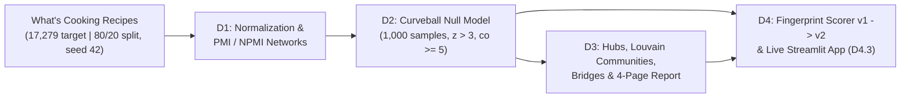

# Culinary Fingerprint

**Statistically Validated Ingredient Co-Occurrence Networks and Network-Informed Cuisine Classification**

Culinary Fingerprint studies how ingredient co-occurrence graphs distinguish **Indian**, **Italian**, and **Mexican** cuisine in the Kaggle *What's Cooking* corpus (`17,279` recipes across the three target cuisines, split `80/20` into `13,823` training and `3,456` held-out test recipes with `seed = 42`). The project spans four deliverables (**D1–D4**): raw PMI/NPMI network construction, Curveball null-model backbone extraction, meso-scale structural analysis (hubs, Louvain communities, cross-cuisine bridges), and interpretable network-based cuisine scoring (**Scorer v1 → Scorer v2** plus an interactive **Streamlit** demo app).

---

## Table of Contents

- [Pipeline Overview](#pipeline-overview)
- [Deliverables Summary](#deliverables-summary)
- [Dataset & Preprocessing](#dataset--preprocessing)
- [D1: Ingredient Co-Occurrence Networks](#d1-ingredient-co-occurrence-networks)
- [D2: Curveball Null Model & Validated Backbones](#d2-curveball-null-model--validated-backbones)
- [D3: Hubs, Louvain Communities & Cross-Cuisine Bridges](#d3-hubs-louvain-communities--cross-cuisine-bridges)
- [D4: Fingerprint Scorer (v1 to v2) & Live App](#d4-fingerprint-scorer-v1-to-v2--live-app)
  - [D4.1 Scorer v1 (Original NPMI Sum)](#d41-scorer-v1-original-npmi-sum)
  - [D4.2 Scorer v2 (Network-Informed, 22 Features)](#d42-scorer-v2-network-informed-22-features)
  - [D4.3 Live Demo App (`outputs/app/`)](#d43-live-demo-app-outputsapp)
- [What We Tried and Learned (D4 Research Phases 1–3)](#what-we-tried-and-learned-d4-research-phases-13)
- [Evaluation Protocol & Leakage Prevention](#evaluation-protocol--leakage-prevention)
- [Limitations](#limitations)
- [Quick Start](#quick-start)
- [Repository Map](#repository-map)

---

## Pipeline Overview



**Core Research Question**: *Can degree-preserving statistical backbone extraction strip out ubiquitous culinary staples (`salt`, `water`, `onion`, `garlic`) to reveal interpretable cuisine structure — and do compact meso-scale network summaries (contrastive backbone pair log-odds, Louvain community coverage, hubs, and cross-cuisine bridges) substantially improve cuisine classification over the original NPMI-sum scorer?*

---

## Deliverables Summary

| Deliverable | Scope | Key Outputs | Output Folder(s) |
| --- | --- | --- | --- |
| **D1** | Deterministic normalization & raw PMI/NPMI networks | `nodes.csv`, `edges_{cuisine}.csv`, `merge_log.csv`, `normalization_report.json` | `outputs/d1_dataset/` |
| **D2** | Curveball null model (`1,000` randomizations) & backbones | `backbone_{cuisine}.csv`, `null_stats_{cuisine}.csv`, `graph_{cuisine}.html` | `outputs/d2_backbone/` |
| **D3** | Top-10 hubs, Louvain communities, bridges & report | `hubs_{cuisine}.csv`, `communities_{cuisine}.csv`, `bridges.csv`, `report.pdf`, 5 figures | `outputs/d3_report/` |
| **D4** | Fingerprint Scorer **v1 → v2**, CV research & **Streamlit app (D4.3)** | `results.csv`, `training_artifacts/`, `final_test_results.csv`, `outputs/app/app.py` | `outputs/d4_scorer/`, `outputs/d4_experiments/`, `outputs/app/` |

---

## Dataset & Preprocessing

- **Source**: Kaggle *What's Cooking* (`data/raw/train.json`, SHA-256 `f18e7e568d1c6067...`), `39,774` total recipes and `428,275` ingredient occurrences across `20` cuisines (`6,714` raw distinct strings; `6,703` after basic lowercase/whitespace cleanup).
- **Target Cuisines (`17,279` recipes, `185,852` raw ingredient occurrences)**:
  - **Indian**: `3,003` total (`2,403` train / `600` test)
  - **Italian**: `7,838` total (`6,270` train / `1,568` test)
  - **Mexican**: `6,438` total (`5,150` train / `1,288` test)
- **Stratified Split (`seed = 42`)**: `13,823` training recipes (`80%`) and `3,456` held-out test recipes (`20%`) persisted in `data/processed/split.json` with zero ID overlap.
- **5-Stage Deterministic Normalizer (`src/normalize.py`)**: `unicode` → `lowercase` → `whitespace` → conservative 71-noun count-plural `singularize` → 5-entry documented botanical `synonym` table (`asafetida` → `asafoetida`, `chat masala` → `chaat masala`, `cuminseed` → `cumin seed`, `garbanzo beans` → `chickpea`, `scallions` → `green onion`). Reduces `4,416` raw strings in the 3 cuisines to `4,402` canonical strings (`720` logged transformations across `14` merge groups; `4` recipes deduplicated).

---

## D1: Ingredient Co-Occurrence Networks

- **Goal**: Construct clean, reproducible ingredient co-occurrence graphs per cuisine weighted by Normalized Pointwise Mutual Information (`NPMI in [-1, 1]`).
- **Method**: Retain eligible ingredients appearing in `>= 20` recipes within each cuisine (`outputs/d1_dataset/nodes.csv`, `1,178` total rows); compute binary recipe presence probabilities and association weights:
  ```text
  P(a) = n(a) / N,   P(a, b) = n(a, b) / N
  PMI(a, b) = log2( P(a, b) / (P(a) * P(b)) )
  NPMI(a, b) = PMI(a, b) / (-log2 P(a, b))   in [-1, 1]
  ```
  Negative associations are preserved in the raw edge tables (`outputs/d1_dataset/edges_{cuisine}.csv`).
- **Key Numbers** (`outputs/d1_dataset/d1_summary.json` and `outputs/d1_dataset/edges_{cuisine}.csv`, descriptive full-dataset scope):
  - **Indian**: `268` eligible nodes (from `1,659` distinct ingredients), `22,284` co-occurring pairs in `edges_indian.csv` (`8,109` with `NPMI < 0`, `1` with `NPMI == 0`, `14,174` with `NPMI > 0`).
  - **Italian**: `487` eligible nodes (from `2,924` distinct ingredients), `48,488` co-occurring pairs in `edges_italian.csv` (`14,514` with `NPMI < 0`, `0` with `NPMI == 0`, `33,974` with `NPMI > 0`).
  - **Mexican**: `423` eligible nodes (from `2,676` distinct ingredients), `42,703` co-occurring pairs in `edges_mexican.csv` (`13,162` with `NPMI < 0`, `4` with `NPMI == 0`, `29,537` with `NPMI > 0`).
- **Output Folder**: `outputs/d1_dataset/`

---

## D2: Curveball Null Model & Validated Backbones

- **Goal**: Separate statistically meaningful culinary pairings from co-occurrences explained merely by ingredient prevalence and recipe length.
- **Method**: Run one degree-preserving **Curveball** bipartite Markov chain (Strona et al., 2014; Numba-accelerated in `src/null_model.py`) per cuisine over the binary recipe-by-ingredient incidence matrix (`1,000` samples, `10 * N` burn-in trades, `2 * N` thinning trades, `seed = 42`). Retain edges with strict `z = (n(a, b) - mu_null) / sigma_null > 3.0` and `co_count >= 5`, excluding zero-variance pairs (`sigma_null = 0`).
- **Key Numbers** (`outputs/d2_backbone/backbone_summary.csv`, `null_model_metadata.json`, `backbone_{cuisine}.csv`):

| Cuisine | Eligible Nodes | Backbone Nodes | Edges Before | Backbone Edges | Retained | Curveball ESS(`S`) |
| --- | ---: | ---: | ---: | ---: | ---: | ---: |
| **Indian** | 268 | 261 | 22,284 | **1,829** | 8.21% | 655 |
| **Italian** | 487 | 473 | 48,488 | **3,758** | 7.75% | 667 |
| **Mexican** | 423 | 408 | 42,703 | **2,847** | 6.67% | 691 |
| **Union** | — | **789** | — | **7,759** unique pairs | — | — |

- **Output Folder**: `outputs/d2_backbone/` (includes offline PyVis HTML visualizations `graph_{cuisine}.html`).

---

## D3: Hubs, Louvain Communities & Cross-Cuisine Bridges

- **Goal**: Quantify meso-scale culinary structure across the validated backbones.
- **Method** (`src/analysis.py`, `src/report.py`):
  - **Hubs**: Top-10 weighted-degree strength (`Strength(a) = sum(max(NPMI(a, b), 0))`) and weighted betweenness centrality (edge distance `1 / max(NPMI, 0)`).
  - **Communities**: Louvain modularity optimization (`seed = 42`, `resolution = 1.0`, weights `max(NPMI, 0)`).
  - **Bridges**: Cross-cuisine bottleneck centrality `Bridge(a; A, B) = min(Strength_A(a), Strength_B(a))` on shared backbone nodes (top-5 per cuisine pair).
- **Key Numbers** (`outputs/d3_report/analysis_summary.json`, `bridges.csv`, `report.md`):
  - **Top Weighted-Degree Hubs**: Indian (`clove` 12.77, `garlic paste` 12.28, `green cardamom` 12.18); Italian (`vanilla extract` 18.24, `carrot` 18.11, `sugar` 15.50); Mexican (`ancho chile pepper` 13.80, `ground cinnamon` 13.04, `dried oregano` 11.51).
  - **Universal vs. Specific Hubs**: Across `26` distinct top-10 strength hubs, **`0` are universal** across all 3 cuisines, `4` appear in two cuisines (`clove`, `all-purpose flour`, `baking powder`, `sugar`), and `22` are cuisine-specific.
  - **Louvain Communities**: Indian `7` (`Q = 0.488`), Italian `6` (`Q = 0.473`), Mexican `7` (`Q = 0.497`), with `0` singleton communities.
  - **Strongest Bridges**: Indian–Italian `bay leaf` (8.21), Indian–Mexican `clove` (9.60), Italian–Mexican `dried oregano` (11.51).
- **Output Folder**: `outputs/d3_report/` (4-page `report.pdf`, `report.md`, CSV tables, and 5 publication PNG figures).

---

## D4: Fingerprint Scorer (v1 to v2) & Live App

All predictive artifacts are built strictly from the **13,823 training recipes** (`outputs/d4_scorer/training_artifacts/`, `1,000` Curveball randomizations: Indian `237` nodes / `1,466` edges; Italian `413` / `2,973`; Mexican `350` / `2,223`; union **`692` backbone nodes** and **`6,149` validated pairs**; `7` Louvain communities per cuisine).

### D4.1 Scorer v1 (Original NPMI Sum)

- **Method** (`src/fingerprint.py`, `src/evaluate.py`): Sums positive validated within-cuisine NPMI across matched recipe ingredient pairs:
  ```text
  Score(c) = sum_{(a, b) in M_c(R)} NPMI_c(a, b)
  ```
  When zero pairs match (or on exact ties), falls back to the training majority class (`italian`).
- **Held-Out Test Result (`N = 3,456`)**: **87.12% Macro-F1**, **87.67% Accuracy**, with **139 zero-score fallbacks**. Dividing the sum by `|M_c(R)|` (the normalized ablation) drops performance to **43.14% Macro-F1** (`43.69%` Accuracy).
- **Output Folder**: `outputs/d4_scorer/`.

### D4.2 Scorer v2 (Network-Informed, 22 Features)

- **Method** (`src/d4_experiments/phase3_scorer_v2.py`, `phase3_final_test.py`): Combines **22 purely network-derived features** in a standardized L2-regularized logistic regression (`C = 1.0`, selected by 3-fold inner CV on 3-fold cross-fitted training meta-features):
  1. **Backbone pair log-odds sums (3)**: For each cuisine `c` over matched pairs in the `6,149` training backbone pairs (`eps = 1e-6`):
     ```text
     sum_{(a, b) in M(R)} log( (P(a, b | c) + eps) / (P(a, b | not c) + eps) )
     ```
  2. **Louvain community features (9)**: Fraction of recipe ingredients covered by each cuisine's communities (`3`), max single-community share (`3`), and community spread entropy (`3`).
  3. **D3 structural counts & coverage (9)**: Top-10 weighted-degree hub counts (`3`), top-5 pairwise bridge counts (`3`), and backbone ingredient counts (`3`).
  4. **Recipe length (1)**: Normalized ingredient count.
- **Held-Out Test Comparison (`N = 3,456`, from `outputs/d4_experiments/final_test_results.csv` & `final_test_summary.json`)**:

| Model | Test Macro-F1 (Primary) | 95% Bootstrap CI | Test Accuracy | Indian Recall | Italian Recall | Mexican Recall | Fallbacks |
| --- | ---: | :---: | ---: | ---: | ---: | ---: | ---: |
| **Scorer v1** (Original NPMI Sum, `M0`) | **87.12%** | [85.83%, 88.34%] | 87.67% | 80.00% | 91.71% | 86.34% | 139 |
| **Scorer v2** (Network-Informed, 22 features, `M5`) | **93.99%** | [93.10%, 94.77%] | **94.13%** | **91.33%** | **96.56%** | **92.47%** | **0** |

- **Paired Statistical Comparison (`v2 minus v1`, `N = 3,456`)**:
  - **Δ Macro-F1**: **+6.87 pp** (95% paired bootstrap CI: `[+5.66 pp, +8.04 pp]`; excludes zero).
  - **Δ Accuracy**: **+6.45 pp** (95% paired bootstrap CI: `[+5.35 pp, +7.52 pp]`).
  - **McNemar Exact Test**: Scorer v2 fixes **287** test recipes where Scorer v1 errs while breaking only **64** (**+223 net recipes**, exact binomial `p = 7.66e-35`).
  - **Recall Gains**: Indian **+11.33 pp**, Italian **+4.85 pp**, Mexican **+6.13 pp**.
- **Output Folder**: `outputs/d4_experiments/`.

### D4.3 Live Demo App (`outputs/app/`)

- **Launch**: `streamlit run outputs/app/app.py` (uses `outputs/app/scorer_runtime.py` and self-contained artifacts in `outputs/app/artifacts/`, with zero imports from `src/d4_experiments/`).
- **Features**:
  - Frequency-ordered ingredient multiselect (`4,105` vocabulary terms), 5-stage text paste normalizer (showing recognized vs. unrecognized tokens), and `"Surprise me"` mystery evaluation mode.
  - Single centered **Scorer v2** result card with cuisine-coloured glow (saffron Indian, emerald Italian, crimson Mexican) and per-cuisine confidence bars.
  - **"Why This Prediction"** structural panel (summary table, matched backbone pairs, D3 top-10 hubs, cross-cuisine bridges, and Louvain community coverage ordered with the predicted cuisine tab selected first) + **offline interactive PyVis subgraph**.
  - **Results** tab benchmarking **Baseline (v1)** vs. **Network-informed (v2)** on the `3,456` held-out test recipes, plus a plain-language **How it works** walkthrough.
- **Parity Verification (`tests/test_app.py`)**: Tested on `250` training recipes against the pipeline — exact prediction parity on both Scorer v1 and Scorer v2, with v2 probabilities matching within `< 1e-6`.

---

## What We Tried and Learned (D4 Research Phases 1–3)

1. **Phase 1 — Diagnosing Scorer v1 (`outputs/d4_experiments/diagnostics.md`, 5-fold CV)**:
   - On `676` of `13,823` out-of-fold training recipes (`4.89%`), **zero validated backbone pairs matched** (`n_matched == 0`), causing Scorer v1 to output `0` for all cuisines and fall back to majority-class `italian` (`50.30%` accuracy on that zero-score subset).
   - Even on the `13,147` non-zero recipes (`88.49%` CV accuracy), summing raw positive NPMI favors Italian's denser backbone (`2,973` edges vs. `1,466` for Indian in full training) and provides no negative evidence against competing cuisines.
2. **Phase 2 — Do Raw Pairs Add Signal Beyond Single-Ingredient Features? (`outputs/d4_experiments/phase2_report.md`, nested 5-fold CV)**:
   - **No.** Adding all binary backbone pair indicators to an L2 logistic regression over single-ingredient features slightly **hurt** CV Macro-F1 (`ExpC_bb: 94.76%` vs. backbone unigram `ExpA2: 94.98%`; `ExpC_full_bb: 95.31%` vs. full-vocab unigram `ExpA3: 95.71%`) due to overfitting in the quadratic pair space.
   - However, when restricting to **pair-only** classifiers of matched size (`K` ≈ `4,865` pairs per fold), Curveball `z > 3` pairs (`ExpE_B2_i: 88.75%` CV Macro-F1) outperformed raw NPMI-thresholded pairs (`87.01%`) and random eligible pairs (`87.41%`).
3. **Phase 3 & Held-Out Test — Compact Network Summaries (`outputs/d4_experiments/phase3/phase3_report.md`, `final_test_report.md`)**:
   - Replacing raw binary pair indicators with the `22` compact network features yielded **Scorer v2 (`M5`: `93.84%` CV Macro-F1 / `93.99%` held-out Test Macro-F1)**, decisively improving over Scorer v1 (`+6.87 pp` held-out Macro-F1) with `0` zero-score fallbacks.

---

## Evaluation Protocol & Leakage Prevention

- **Split Before Everything**: Stratified 80/20 split (`seed = 42`, `data/processed/split.json`) created on recipe IDs prior to vocabulary building, frequency thresholding, Curveball randomization, D3 graph extraction, or scorer fitting.
- **Zero-Leakage Nested CV**: All Phase 1–3 diagnostics, pair-set comparisons, and meta-model `C` tuning used paired 5-fold outer CV (`outputs/d4_experiments/cv_folds.json`) and 3-fold inner cross-fitting on training recipes only; the `3,456` test recipes remained sealed until the single pre-registered final evaluation.
- **Automated Leakage & Integrity Suite**: `tests/test_no_leakage.py`, `tests/test_d4_phase2.py`, `tests/test_d4_phase3.py`, and `tests/test_app.py` enforce disjoint IDs, training-only artifact hashes, and runtime parity (**`52` passing tests** total).

---

## Limitations

- **Closed 3-Cuisine Domain**: Only Indian, Italian, and Mexican are modeled; every input recipe is forced into one of those three classes.
- **Part of v2's Gain Comes from Coverage**: Switching from pair-only matching to node/community/length features eliminates v1's `139` zero-score test fallbacks; rare ingredients (`< 20` training recipes) remain outside all validated backbones.
- **Uncorrected `z > 3` Threshold**: Filtering with `z > 3.0` and `co_count >= 5` is a standard heuristic cutoff rather than a multiple-testing-adjusted (FDR/FWER) threshold across `22,284–48,488` pairs (`18k–40k` in training).
- **CV Curveball Budget**: Phase 1–3 outer CV builds used `100` Curveball randomizations (and `50` in inner cross-fitting) as documented compute approximations to the `1,000`-randomization full-training run.
- **Binary Recipe Incidence**: Ingredient quantities, preparation states, and cooking methods are not modeled.

---

## Quick Start

1. **Create and activate a virtual environment, then install dependencies** (includes `streamlit`):
   ```bash
   python -m venv .venv
   # Windows PowerShell:
   .venv\Scripts\Activate.ps1
   # macOS/Linux:
   # source .venv/bin/activate
   pip install -r requirements.txt
   ```

2. **Place the raw dataset**: Ensure Kaggle *What's Cooking* `train.json` is located at `data/raw/train.json` (`data/processed/split.json` is already checked in).

3. **Launch the interactive Streamlit app**:
   ```bash
   streamlit run outputs/app/app.py
   ```

4. **Run validation and tests**:
   ```bash
   python run_all.py --validate-only
   python -m pytest -v
   ```

5. **Reproduce the full D1–D4 baseline pipeline from scratch** *(optional)*:
   ```bash
   python run_all.py
   # Or skip PDF report regeneration:
   python run_all.py --skip-report
   ```

---

## Repository Map

```text
culinary-fingerprint/
├── archive/                  # Archived exploratory scripts, old README, cleanup plan, UI screenshots
├── data/
│   ├── processed/            # Frozen 80/20 split (split.json) & normalized corpus cache
│   └── raw/                  # Raw Kaggle train.json (gitignored)
├── outputs/
│   ├── app/                  # D4.3 self-contained Streamlit app, runtime engine, SVG assets & artifacts
│   ├── d1_dataset/           # D1 normalization reports, nodes, raw PMI/NPMI edge lists
│   ├── d2_backbone/          # D2 Curveball backbones, null diagnostics & offline PyVis HTML graphs
│   ├── d3_report/            # D3 hubs, communities, bridges, 4-page PDF/MD report & figures
│   ├── d4_experiments/       # D4 Phase 1–3 CV diagnostics, Scorer v2 & final held-out test results
│   ├── d4_scorer/            # D4 original Scorer v1 baseline results + training-only backbones
│   ├── poster_outline.md     # Updated research poster outline (D1–D4, v1 -> v2)
│   └── validation_summary.json
├── src/
│   ├── d4_experiments/       # Phase 1–3 CV & final held-out evaluation modules
│   └── *.py                  # Core D1–D4 pipeline modules (normalize, null_model, backbone, analysis, ...)
├── tests/                    # Automated pytest suite (52 tests covering D1–D4, leakage & app parity)
├── config.yaml               # Central pipeline parameters and seed (42)
├── evaluate.py               # Entry point for D4 baseline evaluation
├── Makefile                  # Task shortcuts (preprocess, d1–d4, test, validate, all)
├── requirements.txt          # Pinned Python dependencies (pipeline + Streamlit)
└── run_all.py                # End-to-end pipeline orchestrator and acceptance validator
```
