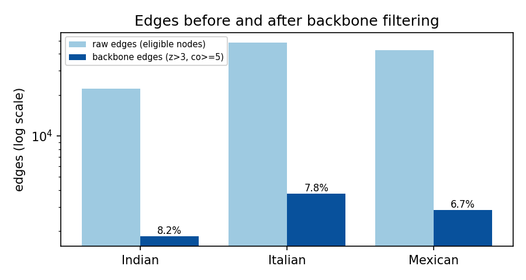
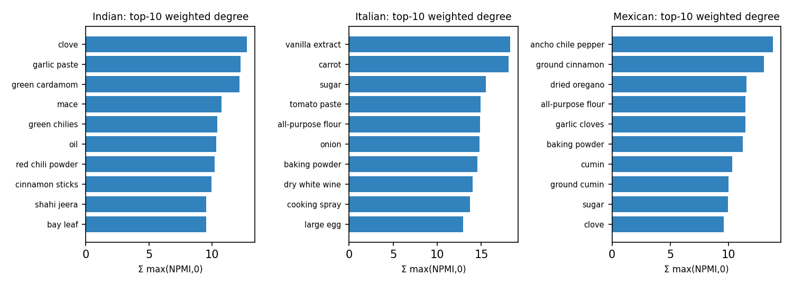
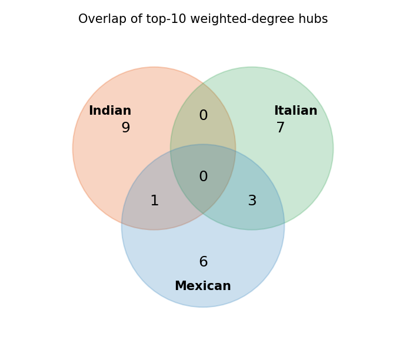
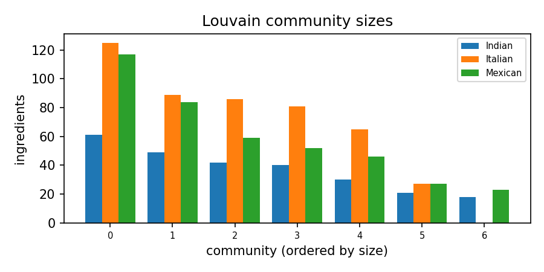
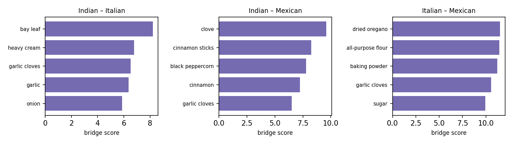

# The Culinary Fingerprint: Hub, Community, and Bridge Analysis of Statistically Validated Ingredient Backbones

## Methodology and Scope

This report characterizes the descriptive ingredient co-occurrence backbones constructed from all 17,279 recipes across Indian (3,003), Italian (7,838), and Mexican (6,438) cuisines in the Kaggle What's Cooking dataset (Table 1). Note that descriptive networks use the full selected dataset, whereas predictive model artifacts in Deliverable 4 are rebuilt exclusively on the 80% stratified training split to prevent data leakage. For each cuisine with N recipes, binary recipe-level ingredient presence defines marginal probabilities P(a) = n(a)/N and joint probabilities P(a,b) = n(a,b)/N among eligible ingredients occurring in at least 20 recipes (Table 1). Pointwise Mutual Information is defined as PMI(a,b) = log2(P(a,b) / (P(a)P(b))), and Normalized Pointwise Mutual Information is NPMI(a,b) = PMI(a,b) / (-log2 P(a,b)) in [-1, 1] (with limiting convention NPMI = 1 when P(a,b) = 1). To validate edges against degree heterogeneity, one Curveball Markov chain (Strona et al., 2014) is run per cuisine on the full binary recipe-by-ingredient incidence matrix, preserving every recipe's exact ingredient count and every ingredient's exact recipe frequency across 1,000 samples after a burn-in of 10 x N trades and thinning of 2 x N trades per sample (Table 1). Each pair's null mean mu_null and sample standard deviation sigma_null yield z(a,b) = (n(a,b) - mu_null) / sigma_null; pairs with sigma_null = 0 are conservatively excluded, and the statistically validated backbone retains edges satisfying z(a,b) > 3 (strict inequality; an uncorrected single-pair threshold) and co_count >= 5 (Table 1, Figure 1). On each undirected backbone, an ingredient's weighted degree (strength) is Strength(a) = sum of max(NPMI(a,b), 0) over incident backbone edges, normalized weighted betweenness centrality is computed over shortest paths with edge distance d(a,b) = 1 / max(NPMI(a,b), 0) (excluding zero-strength edges), and structural bridge importance between cuisines A and B for shared backbone nodes is Bridge(a; A,B) = min(Strength_A(a), Strength_B(a)) (Tables 2-7, Figures 2-5). In Deliverable 4, the training-only Fingerprint Scorer sums backbone NPMI over matched recipe pairs, Score(c) = sum_{(a,b) in M_c(R)} NPMI_c(a,b), whereas its normalized ablation computes  the matched-pair mean Score_norm(c) = Score(c) / |M_c(R)| (0 if |M_c(R)| = 0); empirically, dividing by |M_c(R)| achieves substantially lower held-out accuracy than summing, consistent with the structural property that averaging over |M_c(R)| removes cumulative pair-count evidence and allows a single matched edge in one backbone to exceed the multi-edge mean in another.

### Table 1: Dataset, Null-Model Mixing, and Validated Backbone Summary

| Cuisine | Recipes | Distinct Ing. | Eligible (>=20) | Backbone Nodes | Edges Before | Edges After | Retained (%) | Communities | Modularity | Null ESS(S) |
| --- | --- | --- | --- | --- | --- | --- | --- | --- | --- | --- |
| Indian | 3,003 | 1,659 | 268 | 261 | 22,284 | 1,829 | 8.21% | 7 | 0.488 | 655 |
| Italian | 7,838 | 2,924 | 487 | 473 | 48,488 | 3,758 | 7.75% | 6 | 0.473 | 667 |
| Mexican | 6,438 | 2,676 | 423 | 408 | 42,703 | 2,847 | 6.67% | 7 | 0.497 | 691 |

*Figure 1: Raw vs statistically validated backbone edge counts (log scale) and retention percentages across cuisines.*

## (a) Top-10 hubs

In the Indian backbone (261 nodes and 1,829 validated edges, retaining 8.21% of 22,284 raw edges; Table 1, Figure 1), the top three weighted-degree hubs are clove (strength 12.77, rank 1, betweenness 0.0170 [rank 38], prevalence 10.19%), garlic paste (strength 12.28, rank 2, betweenness rank 20, prevalence 7.36%), and green cardamom (strength 12.18, rank 3, betweenness rank 17, prevalence 2.56%) (Table 2, Figure 2). By weighted betweenness centrality (distance 1/max(NPMI,0)), the highest-ranked brokers in Indian are peeled fresh ginger (betweenness 0.0540, rank 1; strength 8.60, rank 13) and heavy cream (betweenness 0.0397, rank 2; strength 6.79, rank 25), with no ingredients appearing in the top 10 on both metrics (Table 2, Figure 2).

In the Italian backbone (473 nodes and 3,758 validated edges, retaining 7.75% of 48,488 raw edges; Table 1, Figure 1), the top three weighted-degree hubs are vanilla extract (strength 18.24, rank 1, betweenness 0.0235 [rank 15], prevalence 2.79%), carrot (strength 18.11, rank 2, betweenness rank 1, prevalence 4.84%), and sugar (strength 15.50, rank 3, betweenness rank 32, prevalence 9.70%) (Table 3, Figure 2). By weighted betweenness centrality (distance 1/max(NPMI,0)), the highest-ranked brokers in Italian are carrot (betweenness 0.0527, rank 1; strength 18.11, rank 2) and cooking spray (betweenness 0.0466, rank 2; strength 13.69, rank 9), with carrot, baking powder, cooking spray appearing in the top 10 on both metrics (Table 3, Figure 2).

In the Mexican backbone (408 nodes and 2,847 validated edges, retaining 6.67% of 42,703 raw edges; Table 1, Figure 1), the top three weighted-degree hubs are ancho chile pepper (strength 13.80, rank 1, betweenness 0.0387 [rank 3], prevalence 2.07%), ground cinnamon (strength 13.04, rank 2, betweenness rank 5, prevalence 2.73%), and dried oregano (strength 11.51, rank 3, betweenness rank 52, prevalence 8.05%) (Table 4, Figure 2). By weighted betweenness centrality (distance 1/max(NPMI,0)), the highest-ranked brokers in Mexican are cooking spray (betweenness 0.0460, rank 1; strength 7.85, rank 30) and baking powder (betweenness 0.0425, rank 2; strength 11.22, rank 6), with ancho chile pepper, ground cinnamon, baking powder appearing in the top 10 on both metrics (Table 4, Figure 2).

### Table 2: Top-10 Weighted-Degree and Top-10 Weighted-Betweenness Hubs in Indian

| Ingredient | Strength | Str. Rank | Betweenness | Btw. Rank | Deg. | Prev. (%) | Top-10 Str. | Top-10 Btw. |
| --- | --- | --- | --- | --- | --- | --- | --- | --- |
| clove | 12.77 | 1 | 0.0170 | 38 | 48 | 10.19% | Yes | No |
| garlic paste | 12.28 | 2 | 0.0227 | 20 | 47 | 7.36% | Yes | No |
| green cardamom | 12.18 | 3 | 0.0235 | 17 | 36 | 2.56% | Yes | No |
| mace | 10.75 | 4 | 0.0245 | 14 | 28 | 1.43% | Yes | No |
| green chilies | 10.44 | 5 | 0.0228 | 19 | 51 | 16.12% | Yes | No |
| oil | 10.36 | 6 | 0.0196 | 31 | 50 | 18.18% | Yes | No |
| red chili powder | 10.22 | 7 | 0.0103 | 71 | 41 | 5.69% | Yes | No |
| cinnamon sticks | 9.97 | 8 | 0.0225 | 22 | 36 | 8.52% | Yes | No |
| shahi jeera | 9.55 | 9 | 0.0226 | 21 | 22 | 0.67% | Yes | No |
| bay leaf | 9.54 | 10 | 0.0103 | 72 | 34 | 3.93% | Yes | No |
| peeled fresh ginger | 8.60 | 13 | 0.0540 | 1 | 32 | 5.16% | No | Yes |
| heavy cream | 6.79 | 25 | 0.0397 | 2 | 28 | 3.50% | No | Yes |
| active dry yeast | 5.55 | 45 | 0.0341 | 3 | 15 | 1.13% | No | Yes |
| curry leaves | 7.16 | 22 | 0.0308 | 4 | 29 | 6.93% | No | Yes |
| ground cardamom | 4.68 | 63 | 0.0304 | 5 | 19 | 5.79% | No | Yes |
| ground red pepper | 6.00 | 35 | 0.0297 | 6 | 22 | 3.00% | No | Yes |
| boneless chicken skinless thigh | 4.72 | 62 | 0.0294 | 7 | 21 | 2.06% | No | Yes |
| green cardamom pods | 4.41 | 75 | 0.0291 | 8 | 15 | 2.26% | No | Yes |
| saffron | 6.50 | 29 | 0.0284 | 9 | 23 | 2.50% | No | Yes |
| large garlic cloves | 4.05 | 84 | 0.0268 | 10 | 15 | 1.96% | No | Yes |

### Table 3: Top-10 Weighted-Degree and Top-10 Weighted-Betweenness Hubs in Italian

| Ingredient | Strength | Str. Rank | Betweenness | Btw. Rank | Deg. | Prev. (%) | Top-10 Str. | Top-10 Btw. |
| --- | --- | --- | --- | --- | --- | --- | --- | --- |
| vanilla extract | 18.24 | 1 | 0.0235 | 15 | 59 | 2.79% | Yes | No |
| carrot | 18.11 | 2 | 0.0527 | 1 | 83 | 4.84% | Yes | Yes |
| sugar | 15.50 | 3 | 0.0148 | 32 | 66 | 9.70% | Yes | No |
| tomato paste | 14.90 | 4 | 0.0243 | 12 | 68 | 4.80% | Yes | No |
| all-purpose flour | 14.82 | 5 | 0.0175 | 24 | 68 | 11.71% | Yes | No |
| onion | 14.80 | 6 | 0.0130 | 44 | 91 | 15.82% | Yes | No |
| baking powder | 14.53 | 7 | 0.0263 | 10 | 47 | 2.37% | Yes | Yes |
| dry white wine | 14.01 | 8 | 0.0237 | 13 | 76 | 8.39% | Yes | No |
| cooking spray | 13.69 | 9 | 0.0466 | 2 | 64 | 6.26% | Yes | Yes |
| large egg | 12.91 | 10 | 0.0149 | 31 | 63 | 7.97% | Yes | No |
| arborio rice | 11.55 | 17 | 0.0426 | 3 | 46 | 3.33% | No | Yes |
| ground pork | 9.75 | 32 | 0.0383 | 4 | 37 | 0.92% | No | Yes |
| fresh parmesan cheese | 9.99 | 29 | 0.0312 | 5 | 43 | 3.20% | No | Yes |
| ground beef | 11.93 | 15 | 0.0301 | 6 | 51 | 3.02% | No | Yes |
| celery ribs | 10.26 | 26 | 0.0290 | 7 | 42 | 1.66% | No | Yes |
| caper | 7.55 | 56 | 0.0268 | 8 | 36 | 3.90% | No | Yes |
| part-skim mozzarella cheese | 9.63 | 36 | 0.0265 | 9 | 37 | 2.56% | No | Yes |

### Table 4: Top-10 Weighted-Degree and Top-10 Weighted-Betweenness Hubs in Mexican

| Ingredient | Strength | Str. Rank | Betweenness | Btw. Rank | Deg. | Prev. (%) | Top-10 Str. | Top-10 Btw. |
| --- | --- | --- | --- | --- | --- | --- | --- | --- |
| ancho chile pepper | 13.80 | 1 | 0.0387 | 3 | 46 | 2.07% | Yes | Yes |
| ground cinnamon | 13.04 | 2 | 0.0370 | 5 | 45 | 2.73% | Yes | Yes |
| dried oregano | 11.51 | 3 | 0.0121 | 52 | 66 | 8.05% | Yes | No |
| all-purpose flour | 11.46 | 4 | 0.0159 | 31 | 41 | 5.13% | Yes | No |
| garlic cloves | 11.43 | 5 | 0.0088 | 88 | 70 | 14.31% | Yes | No |
| baking powder | 11.22 | 6 | 0.0425 | 2 | 34 | 2.66% | Yes | Yes |
| cumin | 10.30 | 7 | 0.0259 | 12 | 56 | 9.71% | Yes | No |
| ground cumin | 9.99 | 8 | 0.0082 | 95 | 67 | 20.91% | Yes | No |
| sugar | 9.95 | 9 | 0.0225 | 17 | 41 | 5.33% | Yes | No |
| clove | 9.60 | 10 | 0.0066 | 116 | 27 | 0.89% | Yes | No |
| cooking spray | 7.85 | 30 | 0.0460 | 1 | 33 | 4.18% | No | Yes |
| radish | 9.30 | 14 | 0.0371 | 4 | 39 | 1.68% | No | Yes |
| oregano | 9.45 | 12 | 0.0366 | 6 | 42 | 3.08% | No | Yes |
| smoked paprika | 8.27 | 26 | 0.0298 | 7 | 38 | 1.94% | No | Yes |
| black beans | 8.95 | 21 | 0.0287 | 8 | 50 | 12.60% | No | Yes |
| sesame seed | 9.13 | 17 | 0.0286 | 9 | 23 | 0.70% | No | Yes |
| fat free less sodium chicken broth | 5.39 | 70 | 0.0282 | 10 | 21 | 0.92% | No | Yes |

*Figure 2: Top-10 weighted-degree hubs (sum of nonnegative NPMI on incident backbone edges) for Indian, Italian, and Mexican cuisines.*

## (b) Universal and cuisine-specific hubs

Across the union of 26 distinct top-10 weighted-degree hubs from the three cuisines, 0 ingredients qualify as universal hubs (top-10 in all three backbones), 4 qualify as two-cuisine hubs, and 22 are cuisine-specific hubs appearing in the top 10 of exactly one cuisine (Table 5, Figure 3). The 4 two-cuisine hubs are clove (top-10 in indian & mexican, ranks Indian=1, Italian=-, Mexican=10); all-purpose flour (top-10 in italian & mexican, ranks Indian=94, Italian=5, Mexican=4); baking powder (top-10 in italian & mexican, ranks Indian=74, Italian=7, Mexican=6); sugar (top-10 in italian & mexican, ranks Indian=96, Italian=3, Mexican=9) (Table 5, Figure 3).

Crucially, absence from a cuisine's top-10 weighted-degree hubs—or even absence from a backbone—does not imply culinary absence from recipes: for example, onion is a top-10 weighted-degree hub only in Italian (rank 6, strength 14.80, prevalence 15.82%), yet onion occurs in 39.79% of Indian recipes (backbone strength rank 36, strength 5.87) and 23.19% of Mexican recipes (backbone strength rank 57, strength 6.06) because ubiquitous staples co-occur broadly across many recipe types rather than concentrating into high-NPMI specialist cliques (Table 5).

### Table 5: Classification of All Top-10 Weighted-Degree Hubs Across Cuisines

| Ingredient | Class | Top-10 In | Rank (IN/IT/MX) | Strength (IN/IT/MX) | Prevalence % (IN/IT/MX) |
| --- | --- | --- | --- | --- | --- |
| clove | two-cuisine | indian,mexican | 1/-/10 | 12.8/-/9.6 | 10.2/0.2/0.9 |
| all-purpose flour | two-cuisine | italian,mexican | 94/5/4 | 3.8/14.8/11.5 | 5.0/11.7/5.1 |
| baking powder | two-cuisine | italian,mexican | 74/7/6 | 4.4/14.5/11.2 | 1.6/2.4/2.7 |
| sugar | two-cuisine | italian,mexican | 96/3/9 | 3.7/15.5/10.0 | 11.2/9.7/5.3 |
| bay leaf | cuisine-specific | indian | 10/47/101 | 9.5/8.2/4.2 | 3.9/1.7/1.2 |
| cinnamon sticks | cuisine-specific | indian | 8/-/27 | 10.0/-/8.3 | 8.5/0.2/1.0 |
| garlic paste | cuisine-specific | indian | 2/-/- | 12.3/-/- | 7.4/0.0/0.0 |
| green cardamom | cuisine-specific | indian | 3/-/- | 12.2/-/- | 2.6/0.0/0.0 |
| green chilies | cuisine-specific | indian | 5/-/208 | 10.4/-/2.2 | 16.1/0.0/2.6 |
| mace | cuisine-specific | indian | 4/-/- | 10.7/-/- | 1.4/0.0/0.0 |
| oil | cuisine-specific | indian | 6/433/205 | 10.4/0.4/2.3 | 18.2/1.2/2.8 |
| red chili powder | cuisine-specific | indian | 7/-/- | 10.2/-/- | 5.7/0.0/0.1 |
| shahi jeera | cuisine-specific | indian | 9/-/- | 9.5/-/- | 0.7/0.0/0.0 |
| carrot | cuisine-specific | italian | 54/2/84 | 5.1/18.1/4.9 | 6.6/4.8/2.4 |
| cooking spray | cuisine-specific | italian | 50/9/30 | 5.3/13.7/7.8 | 2.1/6.3/4.2 |
| dry white wine | cuisine-specific | italian | -/8/- | -/14.0/- | 0.3/8.4/0.2 |
| large egg | cuisine-specific | italian | 243/10/28 | 0.5/12.9/8.2 | 0.9/8.0/2.9 |
| onion | cuisine-specific | italian | 36/6/57 | 5.9/14.8/6.1 | 39.8/15.8/23.2 |
| tomato paste | cuisine-specific | italian | 58/4/102 | 4.9/14.9/4.2 | 5.3/4.8/2.3 |
| vanilla extract | cuisine-specific | italian | -/1/13 | -/18.2/9.3 | 0.4/2.8/1.3 |
| ancho chile pepper | cuisine-specific | mexican | -/-/1 | -/-/13.8 | 0.0/0.0/2.1 |
| cumin | cuisine-specific | mexican | 57/-/7 | 5.0/-/10.3 | 5.9/0.0/9.7 |
| dried oregano | cuisine-specific | mexican | -/16/3 | -/11.8/11.5 | 0.0/8.0/8.0 |
| garlic cloves | cuisine-specific | mexican | 28/23/5 | 6.5/10.5/11.4 | 14.9/20.7/14.3 |
| ground cinnamon | cuisine-specific | mexican | 64/40/2 | 4.7/8.9/13.0 | 4.1/1.1/2.7 |
| ground cumin | cuisine-specific | mexican | 72/346/8 | 4.5/1.2/10.0 | 22.7/0.4/20.9 |

*Figure 3: Overlap of top-10 weighted-degree hubs across Indian, Italian, and Mexican backbones.*

## (c) Louvain communities

Louvain partitioning on nonnegative NPMI weights in Indian identifies 7 communities (including 0 singleton communities on disconnected dyads/isolates) with weighted modularity Q = 0.488, led by C0 (size 61, label 'peeled fresh ginger / chopped cilantro fresh / cooking spray'); C1 (size 49, label 'heavy cream / boneless skinless chicken breast / cayenne pepper'); C2 (size 42, label 'garlic paste / oil / coriander powder') (Table 1, Table 6, Figure 4).

Louvain partitioning on nonnegative NPMI weights in Italian identifies 6 communities (including 0 singleton communities on disconnected dyads/isolates) with weighted modularity Q = 0.473, led by C0 (size 125, label 'dry white wine / arborio rice / shallot'); C1 (size 89, label 'carrot / onion / tomato paste'); C2 (size 86, label 'shredded mozzarella cheese / lasagna noodles / tomato sauce') (Table 1, Table 6, Figure 4).

Louvain partitioning on nonnegative NPMI weights in Mexican identifies 7 communities (including 0 singleton communities on disconnected dyads/isolates) with weighted modularity Q = 0.497, led by C0 (size 117, label 'lime / cumin / smoked paprika'); C1 (size 84, label 'shredded cheddar cheese / sour cream / ground beef'); C2 (size 59, label 'dried oregano / ground cloves / bay leaves') (Table 1, Table 6, Figure 4).

All community labels in Table 6 are automatically generated from the top three ingredients by within-community weighted degree and are explicitly reported as data-derived descriptive labels rather than validated semantic classifications (Table 6, Figure 4).

### Table 6: Louvain Communities and Top-5 Intra-Community Members (Data-Derived Descriptive Labels)

| Cuisine | Comm. ID | Size | Data-Derived Label (Top-3) | Top-5 Ingredients by Intra-Community Strength |
| --- | --- | --- | --- | --- |
| Indian | 0 | 61 | peeled fresh ginger / chopped cilantro fresh / cooking spray | peeled fresh ginger (7.38), chopped cilantro fresh (4.91), cooking spray (4.79), garlic cloves (4.37), fresh lemon juice (4.32) |
| Indian | 1 | 49 | heavy cream / boneless skinless chicken breast / cayenne pepper | heavy cream (5.04), boneless skinless chicken breast (5.00), cayenne pepper (4.28), paprika (4.10), fresh ginger (4.08) |
| Indian | 2 | 42 | garlic paste / oil / coriander powder | garlic paste (6.13), oil (5.79), coriander powder (5.77), kasuri methi (5.40), chili powder (4.99) |
| Indian | 3 | 40 | mace / clove / green cardamom | mace (9.63), clove (9.56), green cardamom (8.66), cinnamon sticks (8.20), shahi jeera (7.31) |
| Indian | 4 | 30 | curry leaves / mustard seed / fresh curry leaves | curry leaves (4.81), mustard seed (4.33), fresh curry leaves (3.64), asafoetida powder (3.49), urad dal (3.49) |
| Indian | 5 | 21 | carrot / frozen peas / potato | carrot (2.81), frozen peas (2.51), potato (1.78), cauliflower (1.76), chopped cilantro (1.38) |
| Indian | 6 | 18 | baking powder / active dry yeast / melted butter | baking powder (4.08), active dry yeast (3.85), melted butter (3.52), all-purpose flour (3.46), baking soda (3.19) |
| Italian | 0 | 125 | dry white wine / arborio rice / shallot | dry white wine (10.87), arborio rice (8.94), shallot (6.64), extra-virgin olive oil (6.02), garlic cloves (5.96) |
| Italian | 1 | 89 | carrot / onion / tomato paste | carrot (13.77), onion (8.78), tomato paste (8.51), celery (8.26), bay leaf (7.15) |
| Italian | 2 | 86 | shredded mozzarella cheese / lasagna noodles / tomato sauce | shredded mozzarella cheese (9.90), lasagna noodles (7.87), tomato sauce (7.78), pasta sauce (7.61), ricotta cheese (7.36) |
| Italian | 3 | 81 | vanilla extract / sugar / baking powder | vanilla extract (17.21), sugar (13.45), baking powder (13.03), confectioners sugar (11.85), unsweetened cocoa powder (10.97) |
| Italian | 4 | 65 | purple onion / red wine vinegar / balsamic vinegar | purple onion (5.19), red wine vinegar (4.78), balsamic vinegar (3.58), red bell pepper (3.12), dijon mustard (2.71) |
| Italian | 5 | 27 | warm water / cooking spray / dry yeast | warm water (4.78), cooking spray (4.60), dry yeast (3.85), active dry yeast (3.72), fresh parmesan cheese (3.00) |
| Mexican | 0 | 117 | lime / cumin / smoked paprika | lime (6.81), cumin (6.34), smoked paprika (6.31), black beans (6.07), chili powder (5.82) |
| Mexican | 1 | 84 | shredded cheddar cheese / sour cream / ground beef | shredded cheddar cheese (7.07), sour cream (7.02), ground beef (6.71), taco seasoning mix (5.62), refried beans (5.35) |
| Mexican | 2 | 59 | dried oregano / ground cloves / bay leaves | dried oregano (6.22), ground cloves (6.18), bay leaves (6.06), garlic (4.61), apple cider vinegar (4.56) |
| Mexican | 3 | 52 | black peppercorn / ancho chile pepper / sesame seed | black peppercorn (7.85), ancho chile pepper (7.74), sesame seed (7.31), clove (7.28), white onion (6.07) |
| Mexican | 4 | 46 | all-purpose flour / baking powder / vanilla extract | all-purpose flour (10.29), baking powder (9.80), vanilla extract (8.70), ground cinnamon (8.20), unsalted butter (7.85) |
| Mexican | 5 | 27 | cooking spray / non-fat sour cream / chopped onion | cooking spray (4.67), non-fat sour cream (3.75), chopped onion (3.30), vegetable oil cooking spray (2.70), fat free less sodium chicken broth (2.15) |
| Mexican | 6 | 23 | tequila / fresh lime juice / triple sec | tequila (3.11), fresh lime juice (2.94), triple sec (2.03), honey (1.85), extra-virgin olive oil (1.82) |

*Figure 4: Louvain community size distributions across Indian, Italian, and Mexican backbones.*

## (d) Strongest bridge ingredients

Between Indian and Italian (124 shared backbone nodes eligible as bridge candidates), the top three structural bridges by Bridge(a; A,B) = min(Strength_A(a), Strength_B(a)) are bay leaf (rank 1, bridge score 8.21; strengths 9.54 vs 8.21; prevalences 3.93% vs 1.66%), heavy cream (rank 2, bridge score 6.79), and garlic cloves (rank 3, bridge score 6.52) (Table 7, Figure 5).

Between Indian and Mexican (134 shared backbone nodes eligible as bridge candidates), the top three structural bridges by Bridge(a; A,B) = min(Strength_A(a), Strength_B(a)) are clove (rank 1, bridge score 9.60; strengths 12.77 vs 9.60; prevalences 10.19% vs 0.89%), cinnamon sticks (rank 2, bridge score 8.26), and black peppercorn (rank 3, bridge score 7.79) (Table 7, Figure 5).

Between Italian and Mexican (195 shared backbone nodes eligible as bridge candidates), the top three structural bridges by Bridge(a; A,B) = min(Strength_A(a), Strength_B(a)) are dried oregano (rank 1, bridge score 11.51; strengths 11.83 vs 11.51; prevalences 7.99% vs 8.05%), all-purpose flour (rank 2, bridge score 11.46), and baking powder (rank 3, bridge score 11.22) (Table 7, Figure 5).

These bridge scores quantify shared structural centrality across pairs of validated ingredient backbones and do not imply historical cultural exchange, shared culinary ancestry, or causal influence (Table 7, Figure 5).

### Table 7: Top-5 Structural Bridge Ingredients per Cuisine Pair

| Cuisine Pair | Rank | Ingredient | Strength A | Strength B | Bridge Score | Prev. A (%) | Prev. B (%) |
| --- | --- | --- | --- | --- | --- | --- | --- |
| Indian-Italian | 1 | bay leaf | 9.54 | 8.21 | 8.21 | 3.93% | 1.66% |
| Indian-Italian | 2 | heavy cream | 6.79 | 7.04 | 6.79 | 3.50% | 3.83% |
| Indian-Italian | 3 | garlic cloves | 6.52 | 10.54 | 6.52 | 14.85% | 20.66% |
| Indian-Italian | 4 | garlic | 6.37 | 10.26 | 6.37 | 24.18% | 18.77% |
| Indian-Italian | 5 | onion | 5.87 | 14.80 | 5.87 | 39.79% | 15.82% |
| Indian-Mexican | 1 | clove | 12.77 | 9.60 | 9.60 | 10.19% | 0.89% |
| Indian-Mexican | 2 | cinnamon sticks | 9.97 | 8.26 | 8.26 | 8.52% | 1.04% |
| Indian-Mexican | 3 | black peppercorn | 7.79 | 9.07 | 7.79 | 4.06% | 0.78% |
| Indian-Mexican | 4 | cinnamon | 7.70 | 7.24 | 7.24 | 5.19% | 1.10% |
| Indian-Mexican | 5 | garlic cloves | 6.52 | 11.43 | 6.52 | 14.85% | 14.31% |
| Italian-Mexican | 1 | dried oregano | 11.83 | 11.51 | 11.51 | 7.99% | 8.05% |
| Italian-Mexican | 2 | all-purpose flour | 14.82 | 11.46 | 11.46 | 11.71% | 5.13% |
| Italian-Mexican | 3 | baking powder | 14.53 | 11.22 | 11.22 | 2.37% | 2.66% |
| Italian-Mexican | 4 | garlic cloves | 10.54 | 11.43 | 10.54 | 20.66% | 14.31% |
| Italian-Mexican | 5 | sugar | 15.50 | 9.95 | 9.95 | 9.70% | 5.33% |

*Figure 5: Top-5 bridge ingredients per cuisine pair ranked by Bridge(a; A,B) = min(Strength_A(a), Strength_B(a)).*
